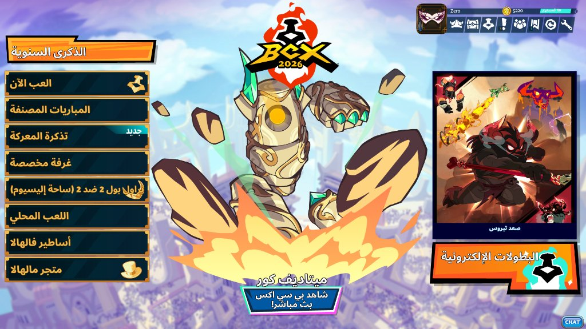
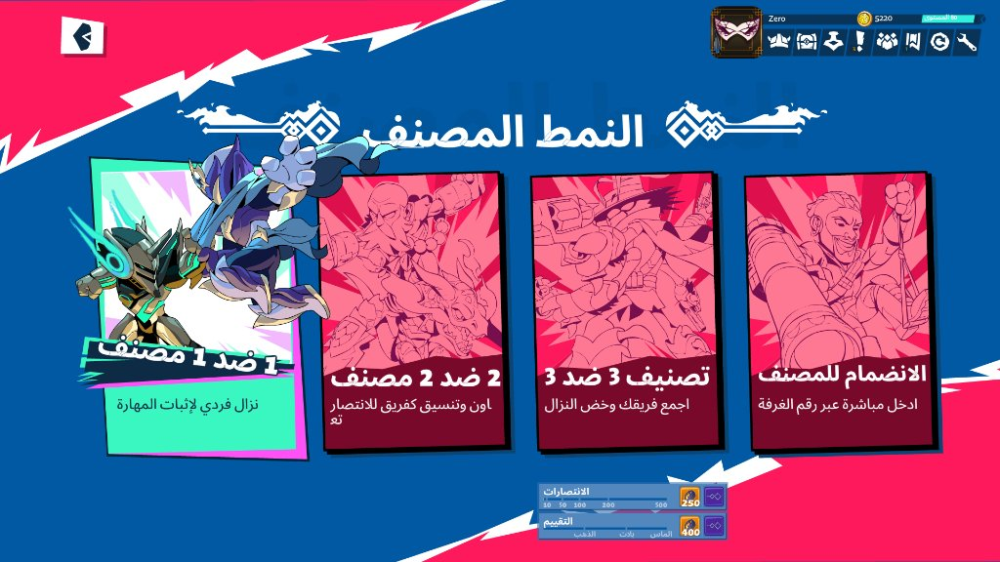
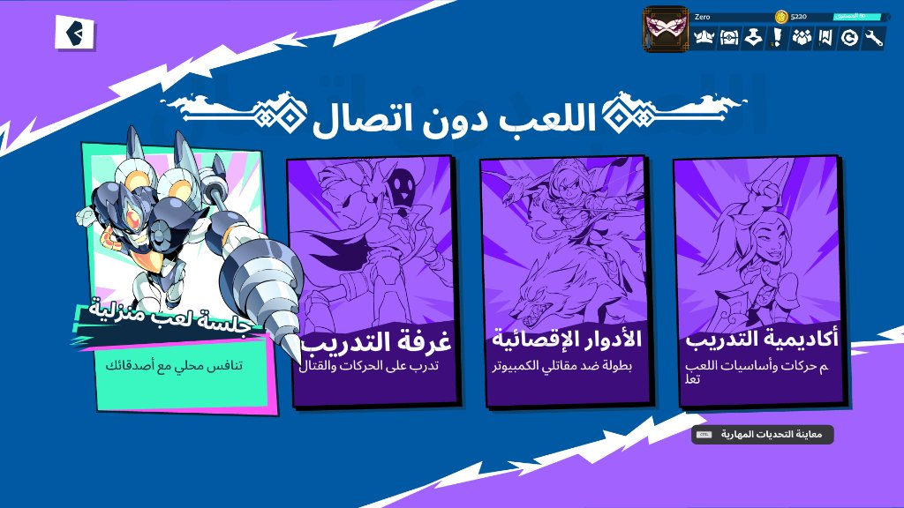
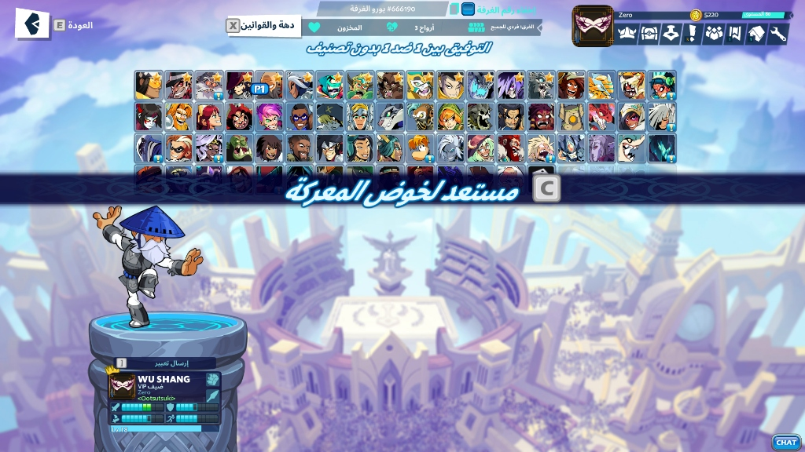
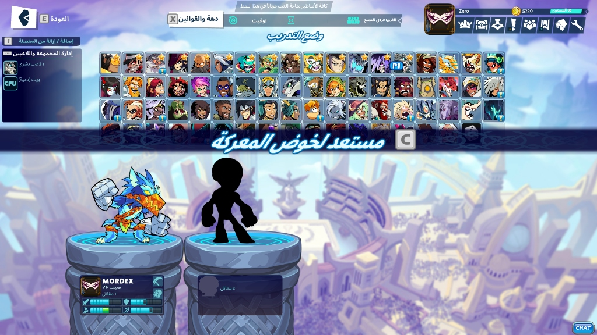
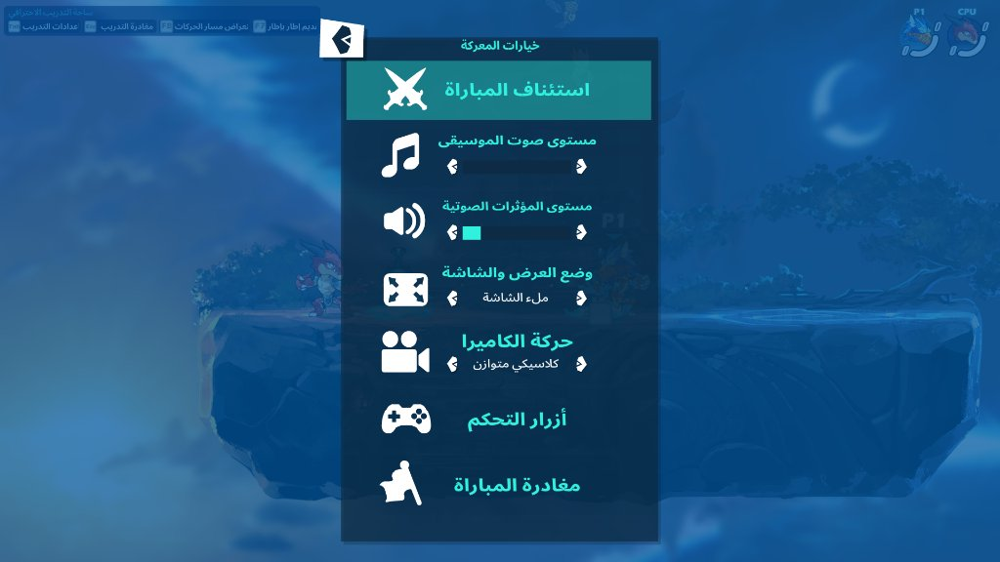

<div align="center">

# ⚔️ التعريب العربي الأصلي للعبة Brawlhalla
### Brawlhalla 100% Native Arabic Localization Mod

[](https://github.com/dahakabdellah12/Arabic-in-Brawlhalla/releases)
[](https://www.brawlhalla.com/)
[](LICENSE)
[](#)

مشروع تعريب عربي أصلي واحترافي وشامل للعبة القتال الشهيرة **Brawlhalla**، صُمم خصيصاً ليمنح اللاعب العربي تجربة متكاملة وكأن اللعبة طُوّرت أساساً باللغة العربية، مع الحفاظ الصارم على تخطيط الواجهة الأصلية وتفادي أي أخطاء في اتجاه النص أو تشويه الخطوط.

</div>

---

## 🌟 مميزات التعريب

- **الحفاظ التام على تخطيط وتصميم الواجهة الأصلية (No Global RTL):** لا يتم عكس القوائم أو الحاويات أو الأزرار، مما يضمن بقاء جميع العناصر في مواضعها المعتادة ومحاذاتها الإنجليزية الأصلية دون أي تشويه بصري.
- **خطوط Noto Sans Arabic متعددة الأوزان (Multi-Weight Font Injection):** تم حقن الخطوط العربية بجميع الأوزان الخمسة المدمجة في المحرك (`Author Medium`, `Author Semibold`, `Author Bold`, `Bespoke Sans Bold`, `Bespoke Sans Extrabold`) مع تغطية كاملة للمحارف بنسبة **100% (0 محارف مفقودة)**.
- **حل مشكلة تقطيع الحروف والنقاط:** دعم كامل لفك المحارف المركبة (Decomposed Composite Glyphs) لضمان ظهور كافة الحروف المتصلة والنقاط والهمزات بدقة عالية ووضوح تام.
- **معجم قتالي تنافسي أصيل (Native Gaming Lexicon):** صياغة لغوية رياضية تنافسية طبيعية صُممت خصيصاً لمجتمع ألعاب القتال التنافسية (FGC):
  - `KO` / `Knockout` ➔ **إقصاء / ضربة قاضية**
  - `Dodge` ➔ **تفادٍ**
  - `Dash` ➔ **اندفاع**
  - `Gravity Cancel` ➔ **إلغاء الجاذبية**
  - `Recovery` ➔ **صعود تعافٍ**
  - `Ground Pound` ➔ **سحقة أرضية**
  - `Light / Heavy Attack` ➔ **ضربة خفيفة / ضربة ثقيلة**
  - `Signature` ➔ **هجوم خارق**
  - `Stock` ➔ **روح قتالية**
- **صيانة الأسماء الأصلية للأساطير (Proper Names):** الحفاظ التام على أسماء الشخصيات والأساطير (`Bödvar`, `Hattori`, `Valhalla`, `Orion`, `Cross`, `Eivor`, `Rayman`) بأحرفها اللاتينية الأصلية لضمان الهوية التنافسية للعبة.
- **تثبيت وسلامة المتغيرات التقنية:** الحفاظ الدقيق على المعاملات البرمجية مثل `{0}` و `{1}` و `%s` وعلامات السطور الجديدة `\n`.
- **ملاءمة دقيقة لحدود الأطر:** تم ضبط أطوال النصوص بدقة هندسية متناهية لتفادي أي التفاف غير مرغوب فيه أو انقطاع في لوحة النتائج والبطاقات.

---

## 📸 لقطات شاشة من داخل اللعبة (In-Game Screenshots)

<div align="center">

### القائمة الرئيسية وأحداث اللعبة (Main Menu & Event Center)


### طور اللعب المصنف التنافسي (Ranked Queues)


### طور اللعب دون اتصال والأنماط المحلية (Offline Play)


### شاشة اختيار الأساطير والتوفيق بين اللاعبين (Character Select & Matchmaking)


### ساحة اختيار نمط التدريب الاحترافي (Training Mode)


### قائمة الخيارات والإعدادات أثناء المباراة (In-Game Pause Menu)


</div>

---

## 🚀 طريقة التثبيت

### الطريقة الأولى: التثبيت التلقائي بنقرة واحدة (موصى بها) ⚡

1. قم بتحميل المستودع عبر الضغط على **Code > Download ZIP** أو من صفحة [Releases](https://github.com/dahakabdellah12/Arabic-in-Brawlhalla/releases).
2. فك الضغط عن الملف في أي مكان تريده على جهازك.
3. اضغط مرتين على ملف **`install.bat`**.
4. سيتعرف المثبت تلقائياً على مسار لعبة Brawlhalla على Steam ويقوم بالتالي:
   - إنشاء نسخة احتياطية من ملفاتك الأصلية تلقائياً.
   - تثبيت ملف اللغة العربية والخطوط المعدلة في مسارها الصحيح.
5. افتح اللعبة واستمتع بالتعريب العربي الكامل!

---

### الطريقة الثانية: التثبيت اليدوي المباشر 📁

إذا كنت تفضل نسخ الملفات بنفسك دون استخدام سكربت التثبيت:

1. توجه إلى مجلد اللعبة على جهازك:
   - المسار الافتراضي: `SteamLibrary\steamapps\common\Brawlhalla`
2. انسخ ملف `game_files\languages\language.1.bin` والصقه داخل مجلد:
   ```
   Brawlhalla\languages\
   ```
3. انسخ ملف `game_files\fontData\Font_Latin.swf` والصقه داخل مجلد:
   ```
   Brawlhalla\fontData\
   ```
4. وافق على الاستبدال (يُفضل أخذ نسخة احتياطية من الملفين الأصليين أولاً).

---

## 🔄 كيفية إلغاء التثبيت واستعادة الملفات الأصلية

إذا أردت العودة إلى النسخة الأصلية للعبة في أي وقت:

- **تلقائياً:** اضغط مرتين على ملف **`uninstall.bat`** وسيقوم باستعادة نسختك الاحتياطية فوراً.
- **أو عبر Steam:** كليك يمين على لعبة Brawlhalla في مكتبتك > **خصائص (Properties)** > **الملفات المثبتة (Installed Files)** > **التحقق من سلامة ملفات اللعبة (Verify integrity of game files)**.

---

## 🛠️ هيكل المشروع ومحتويات المستودع

```plaintext
Arabic-in-Brawlhalla/
│
├── game_files/                     # ملفات اللعبة الجاهزة للاستخدام المباشر
│   ├── languages/
│   │   └── language.1.bin          # قاعدة بيانات النصوص المعربة والمشكلة مسبقاً
│   └── fontData/
│       └── Font_Latin.swf          # حزمة الخطوط المحقونة بـ Noto Sans Arabic
│
├── assets/
│   └── screenshots/                # لقطات شاشة المعاينة من داخل اللعبة
│
├── toolchain/                      # أدوات البناء والتطوير والقواميس (للمطورين)
│   ├── lexicon.py                  # المعجم الموحد للمصطلحات القتالية التنافسية
│   ├── translation_rules.py        # محرك القواعد ومطابقة القواميس والأنماط
│   ├── arabic_reshaper_bidi.py     # محرك تشكيل الحروف العربية وضبط BiDi للعبة
│   ├── arabic_font_injector.py     # أداة حقن خطوط TrueType وتفكيك الرسوم المركبة
│   ├── build_arabic_language.py    # مجمع ومولد قاعدة بيانات لغة اللعبة الثنائية
│   ├── verify_full_localization.py # أداة التحقق الشامل من تغطية المحارف بنسبة 100%
│   ├── translations_*.py           # قواميس الترجمة التخصصية لكافة أقسام اللعبة
│   └── fonts/                      # خطوط Noto Sans Arabic المستخدمة في الحقن
│
├── install.bat                     # مثبت الويندوز السريع بنقرة واحدة
├── install_arabic_mod.py           # سكربت التثبيت التلقائي الذكي بلغة بايثون
├── uninstall.bat                   # أداة استعادة الملفات الأصلية السريعة
├── uninstall_arabic_mod.py         # سكربت إزالة التثبيت الذكي
├── LICENSE                         # ترخيص المشروع مفتوح المصدر (MIT)
└── README.md                       # دليل المشروع والتعليمات الكاملة
```

---

## 👨‍💻 للمطورين والمساهمين

إذا كنت ترغب في تعديل أو إضافة أي مصطلحات وبناء ملفات اللغة والخط بنفسك:

1. تأكد من تثبيت متطلبات بايثون:
   ```bash
   pip install fonttools arabic-reshaper python-bidi
   ```
2. لإعادة بناء قاعدة بيانات اللغة العربية:
   ```bash
   python toolchain/build_arabic_language.py
   ```
3. للتحقق من دعم جميع المحارف داخل الخط المعدل بنسبة 100%:
   ```bash
   python toolchain/verify_full_localization.py
   ```

---

## 📄 الترخيص (License)

هذا المشروع مرخص تحت رخصة **[MIT License](LICENSE)** - يحق لك استخدام وتعديل وتطوير المشروع بحرية تامة مع الحفاظ على حقوق الملكية الفكرية.

> **ملاحظة قانونية:** لعبة Brawlhalla وجميع شخصياتها وشعاراتها هي علامات تجارية مسجلة لشركة **Blue Mammoth Games** وشركة **Ubisoft**. هذا التعريب هو مشروع مجتمعي غير رسمي من قِبل اللاعبين ولصالح مجتمع اللاعبين العرب.

---

<div align="center">

صُنع بـ ❤️ لجميع مجتمع ومحبي لعبة **Brawlhalla** في الوطن العربي.

إذا نال المشروع إعجابك، لا تنسَ دعم المستودع بنجمة ⭐ على GitHub!

</div>
